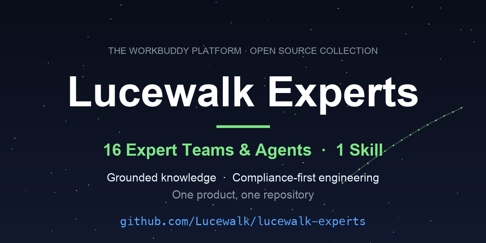

# Lucewalk Lumen · 沐光行客

> **Brand hub** — expert teams, agents and skills built for the [WorkBuddy](https://www.workbuddy.cn) AI assistant platform, maintained by [Xing Bu](https://github.com/Lucewalk).
>
> Grounded knowledge · compliance-first engineering · one product, one repository

## About me

I'm **Xing Bu** — an OB & HRM academic, a peer reviewer for management journals, and the author of 16+ expert teams and skills published on the WorkBuddy Expert Center.

Every product here is shaped by three disciplines I bring from my daily work:

- **From peer review — the grounding discipline.** I review manuscripts for a living, so my agents are built to answer the way a reviewer reads: every scale points to its source publication, every theory entry carries its literature trail, and when evidence is missing the agent says *so* instead of improvising. Several packages ship with dedicated citation-integrity and de-AI-flavor rules.
- **From engineering — the compliance discipline.** Packages go through a sensitive-info and ownership precheck before publication; the ones that touch personal data ship with `PRIVACY.md`, encrypted PII handling and desensitized archives; operations are reversible by design; and every package has exactly one version source of truth.
- **From teaching — the workflow discipline.** Each expert is modeled on a real course, research project or consulting engagement, then iterated across semesters of actual use until it earns its own repository. Sixteen of them made it to the platform.

## The three product lines

### 🔬 Research line — knowledge that shows its sources

For OB & HRM scholars: theory and scale knowledge bases that answer with citations, bibliometric analysis of your own library, and statistics coaching that explains *why* a model fits — not just the syntax.

| Product | What makes it different |
|---|---|
| [obhrm-brain-trust](https://github.com/Lucewalk/obhrm-brain-trust) | A theory & scale knowledge base with **grounded, citation-first answers** — fuzzy word-form matching that still respects exact provenance, explicit "not covered by source" labels, maturity-gated entries (idea → draft → official → archive), and coverage tracking across 130+ theory entries and curated scales (from Hawthorne studies to the burnout three-dimensional model). |
| [academic-literature-analysis-team](https://github.com/Lucewalk/academic-literature-analysis-team) | Bibliometric analysis over your own library — from raw exports to a **review skeleton** you can actually write against. |
| [mplus-stats-coach](https://github.com/Lucewalk/mplus-stats-coach) | Statistics coaching for Mplus — syntax guidance, modeling decisions and output interpretation, tuned for students who need to defend their choices. |
| [endnote-analysis-expert](https://github.com/Lucewalk/endnote-analysis) | Turns an EndNote library into citation-structure and research-profile insights — built on the author's own daily literature-management workflow. |

> The line's flagship, **obhrm-research-collaboration-team** (full research pipeline: literature review, paper writing, methods, data analysis, peer review and journal selection, with EndNote/Zotero library import), is closed-source and distributed via the WorkBuddy Expert Center only.

### 🎓 Teaching line — built on real classrooms, semester after semester

For higher-education teachers: course building, case writing, assessment and classroom operations, each expert modeled on an actual course and sharpened through semesters of use.

| Product | What makes it different |
|---|---|
| [teaching-helper-team](https://github.com/Lucewalk/teaching-helper-team) | The deepest teaching pack — **nine experts and 18 skills** covering course architecture, case writing, material extraction, knowledge wikis, plus built-in citation-integrity and de-AI-flavor rules for classroom deliverables. |
| [course-tutor](https://github.com/Lucewalk/course-tutor) | Course companion for teachers (v2.4.0, full build source): roster import, learning analytics, participation scoring, weekly teaching briefings — nine Python modules and a data-hub config you can audit and extend. Ships with a student-edition build pipeline. |
| [campus-ppt-helper](https://github.com/Lucewalk/campus-ppt-helper) | A six-member team for teaching and academic slide decks — from outline to speaker-ready pages. |
| [erp-teaching-team](https://github.com/Lucewalk/erp-teaching-team) | Seven experts for ERP courses — course design, cases and lab setups grounded in real enterprise processes. |
| [college-competition-coaching-team](https://github.com/Lucewalk/college-competition-coaching-team) | Competition coaching for student teams — planning, mentoring and stage-gate review. |

### 🧭 Practice & tooling line — consulting discipline and the factory that builds the ecosystem

China-market HRM consulting with privacy engineering, plus the tooling that builds, audits and maintains this ecosystem itself.

| Product | What makes it different |
|---|---|
| [hrm-advisory-corps](https://github.com/Lucewalk/hrm-advisory-corps) | China-market HRM consulting — one orchestrator plus eight specialists across org planning, recruiting pipeline, talent development, performance, compensation and **labor compliance**. Handles candidate PII the compliant way: desensitized archives, encrypted PII vault, plaintext never touching ordinary files. |
| [workbuddy-expert-studio](https://github.com/Lucewalk/workbuddy-expert-studio) | **The factory behind this whole catalog** — a team that takes an expert idea through alignment, drafting, quality gates and packaging until it is publishable. Every product listed on this page was produced with it. |
| [kb-library-team](https://github.com/Lucewalk/kb-library-team) | Knowledge-base governance — one chief knowledge officer with six internalized domains (ingest, classify, promote, index, grounded Q&A, archive), four-pool maturity gates and hard ingestion guardrails (≤50 files per batch). |
| [ai-butler](https://github.com/Lucewalk/ai-butler) | Teacher workbench (offline-first): todos, schedule, teaching calendar with `.ics` import, morning/weekly briefings — single-file HTML plus a local bridge, your data never leaves the machine; optional end-to-end encrypted sync. |
| [distill](https://github.com/Lucewalk/distill) | Condense long material into structured, citable summaries — reading time in, reference-ready out. |
| [ghost-workspace-hunter](https://github.com/Lucewalk/ghost-workspace-hunter) | Skill — reversible cleanup of corrupted WorkBuddy workspaces: database backup first, active-session guard, trash instead of delete. |

## Why separate repositories?

These experts and skills solve very different problems and each has real depth — a single combined repo could not do any of them justice. One product, one repository: focused docs, its own issue tracker, its own release cycle. This repository is the catalog and entry point.

## Install (any product)

1. Download the package zip from the product's **Releases** page (or clone its repo);
2. Unzip keeping the internal manifest structure intact (`.codebuddy-plugin/`; `ai-butler` uses an `agent-card.json` UMAS manifest);
3. Import/register in WorkBuddy (custom connector → trust & enable).

## Quality & security

- Every package passed a sensitive-info & ownership precheck before publication — see [docs/PRECHECK.md](docs/PRECHECK.md);
- Version source of truth: the `version` field in each package's `.codebuddy-plugin/plugin.json`;
- Cross-package version alignment history: [CHANGELOG.md](CHANGELOG.md);
- Found a problem? Open an issue on the product's own repository, or start a [Discussion](https://github.com/Lucewalk/about-me/discussions).

## Citation

If any of these expert packs or skills are useful in your research or teaching, please cite the repository — see [CITATION.cff](CITATION.cff).

## License

MIT — see [LICENSE](LICENSE). Third-party assets are documented in each product's `SOURCES.md` / `references/`.

---

<strong>📖 中文说明(Chinese README)</strong>

# Lucewalk Lumen

**Lucewalk Lumen(沐光行客)**——沐光而行,以光为伴——是我为 WorkBuddy AI 助手平台打造的专家团、专家与技能合集的品牌门户。

## 品牌逻辑

- **Grounded knowledge(有据可依)**——审稿人职业习惯的产品化:量表指向来源、理论链接文献、缺失证据标注缺失;
- **Compliance-first engineering(合规优先)**——发布前敏感信息预检、PRIVACY/SECURITY 文档、可逆操作、每包单一版本真源;
- **One product, one repository(一产品一仓库)**——每个产品独立成仓,拥有自己的文档、Issue 与发布周期。

## 产品目录(三条产品线)

### 🔬 研究线(OB & HRM)
- [obhrm-brain-trust](https://github.com/Lucewalk/obhrm-brain-trust):12 章教材 × 145 理论 × 601 量表 × 108 R 方法的四库溯源问答
- [academic-literature-analysis-team](https://github.com/Lucewalk/academic-literature-analysis-team):学术文献计量分析,从题录到综述骨架
- [mplus-stats-coach](https://github.com/Lucewalk/mplus-stats-coach):语法实验室、方法顾问与输出门诊三环辅导
- [endnote-analysis-expert](https://github.com/Lucewalk/endnote-analysis):EndNote 引用结构与综述骨架

### 🎓 教学线
- [teaching-helper-team](https://github.com/Lucewalk/teaching-helper-team):九专家十八技能,三层架构,六大预设工作流
- [course-tutor](https://github.com/Lucewalk/course-tutor):课程伴学精灵·教师版(含完整源码与学生版构建线)
- [campus-ppt-helper](https://github.com/Lucewalk/campus-ppt-helper):六成员流水线的教学课件制作
- [erp-teaching-team](https://github.com/Lucewalk/erp-teaching-team):五教练覆盖选型、概念、练习、进度全周期
- [college-competition-coaching-team](https://github.com/Lucewalk/college-competition-coaching-team):大学生赛事教练团

### 🧭 实践与工具线
- [hrm-advisory-corps](https://github.com/Lucewalk/hrm-advisory-corps):一主理人八专家的 HRM 实战咨询,PII 加密处理
- [workbuddy-expert-studio](https://github.com/Lucewalk/workbuddy-expert-studio):本合集所有产品的诞生地
- [ai-butler](https://github.com/Lucewalk/ai-butler):教师工作台(离线优先)
- [distill](https://github.com/Lucewalk/distill):蒸馏师——长文进、可引用摘要出
- [ghost-workspace-hunter](https://github.com/Lucewalk/ghost-workspace-hunter):幽灵工作空间猎手(技能)

> 闭源旗舰 obhrm-research-collaboration-team 仅经 WorkBuddy 专家中心分发。

## 安装(任一产品)

1. 从产品仓库的 Releases 页下载 zip(或克隆仓库);
2. 解压保持内部清单结构不变(`.codebuddy-plugin/`);
3. 在 WorkBuddy 中导入/注册(自定义连接器 → 信任并启用)。

## 许可

MIT——详见 [LICENSE](LICENSE)。

