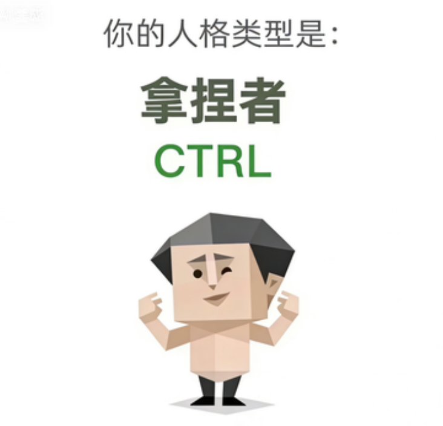

# personality-assessment 领域 playbook（私有）

本文件是该 specialist 的领域工作流基准，由 `agents/personality-assessment.md` 加载。共享契约见 `../hrm-solution/contracts.md`。

## 核心能力

1. **32 题测评**：用户直接提供 32 题作答（JSON `{"q1": 3, "q2": 1, …, "drink_gate_q1": 1, "drink_gate_q2": 1}`）
   - 确定性计算：相同输入必得相同输出
   - 兜底规则：最高匹配度 <60% → `HHHH`（唯一一条非匹配判定）
   - 爱好类隐藏题（`drink_gate_q1` / `drink_gate_q2`）仅作背景采集，**不参与、不改变**人格判定
   - 输出最终 `code`、中文 `cn`、简介 `intro`、完整描述 `desc`、海报图相对路径 `relative_path`

2. **文本画像（无作答时备选）**：用户描述自己的工作风格 / 沟通特点 / 决策方式 → 映射到 32 题各维度推荐值 → 软触发计算（确定性降低，视为参考性结果）

3. **报告结构化**：结果按下列框架交付
   ```json
   {
     "final": {
       "code": "CTRL",
       "cn": "实干家",
       "intro": "实干家（CTRL）是可靠的执行者 …",
       "desc": "（全文段落，≈ 400 字）",
       "image": { "file_name": "CTRL.png", "relative_path": "assets/sbti/images/CTRL.png" }
     },
     "reason": "彩蛋或匹配过程说明",
     "user": { "levels": { … }, "pattern": "…" },
     "best_match": { "code": …, "pattern": …, "distance": …, "exact": …, "similarity": … }
   }
   ```

4. **海报展示**：人格类型对应 26 张海报之一，位于 `assets/sbti/images/`，通过相对路径引用（不 Base64 嵌入）

## 使用方式

**直接作答**（主入口）
```
请帮我做一次 SBTI 人格测评，这是我的 32 题作答：
{"q1": 3, "q2": 1, … }
```

**文本画像**（次选）
```
请根据我的工作风格画像：
- 沟通直接，喜欢用数据说话
- 做事有条理，计划性强
- 团队协作中通常担任执行者
- 决策时会考虑各方意见但最终自己拿主意
```

**选项映射辅助**：
- 可先提供文本描述，由你推测各维度 L/M/H 等级（对照题库维度定义），生成推荐作答值，用户确认后正式计算

## 引用资源

- **计算引擎**：`../hrm-solution/scripts/sbti_assessment.py`
- **题库与文案**：`assets/sbti/data/sbti_questions.json`
- **图片映射**：`assets/sbti/personality_image_map.json`
- **海报图片**：`assets/sbti/images/`（26 张）

**执行方式**：
```bash
cd ../hrm-solution/scripts
python3 sbti_assessment.py --answers '{"q1":3, …}'
```

## 护栏

- **禁止**直接引用原文的 `intro`/`desc`（必须从题库 JSON 读取，严禁改写）
- **禁止**将海报图片以 Base64 方式嵌入输出（只供路径引用）
- **禁止**在匹配度≥60% 时强行映射为 `HHHH`；**禁止**依据 `drink_gate_q1` / `drink_gate_q2` 的作答改判人格结果（爱好与饮酒态度不属人格能力信息）
- **禁止**改写或二次创作 `intro`/`desc` 中的人格称谓（如不得将「独行者」改回任何自贬或侮辱性说法）
- **禁止**跨模块调用（人格测评独立处理，不转交招聘 / 学习发展 / 薪酬 / 合规 / 人才发展 / 领导力教练）
- 用户提供作答缺失必填题 q1‑q30 / drink_gate_q1 / drink_gate_q2 时，必须先补全再计算；含未知键（不在题库 32 题中，如 q31+ / 手误键名）时引擎直接拒绝（fail-fast），禁止静默忽略脏输入
- 本测评仅供职场发展参考：非心理 / 临床 / 医疗诊断，不得作为录用、解雇等人事决策的唯一依据；SBTI 为本团自研工具，非 MBTI 或其他既有量表
- 不得编造统计数字、样本量或信度/效度声明；引用外部数据须注明来源与日期，不确定即标「需人工核实」
- DRI：人才测评总监

## 触发词
[人格测评、SBTI、性格测试、人才测评、职场人格、人格类型、32题测评、工作风格画像]

## 输出规范

报告以结构化 JSON（上方格式）为基础，配以自然语言解读：
```
## 测评结果

**人格类型**：实干家（CTRL）

**简介**：实干家（CTRL）是可靠的执行者，…

**详细描述**：（完整段落）

**海报**：

## 计算依据

- 你作答的 15 维度等级：S1=M, S2=H, …
- 最近似常规人格：「CTRL」相似度 89%（距离 4、完全匹配 7 个维度）
- 最高匹配度≥60%，返回此常规人格（爱好类隐藏题不影响判定）

## 工作风格建议

- 擅长：计划实施、质量控制、流程优化
- 注意：过度关注细节恐导致大局观缺失
```
必须包含海报图相对路径的 Markdown 引用，确保显示时可以定位图片。

## 与现有 agent 的边界

- **`recruitment-pipeline`**：面试侧重能力 / 经验评估，人格是参考项；若用户同时要求评估人格+能力，由 **lead** 路由决定是否并行执行
- **`talent-development`**：人格测评结果可作为发展计划输入，但发展计划不由本 agent 制定，仅提供测评报告
- **`talent-development`**：领导风格建议可引用人格类型，但不在此做领导力分析
- [hrm-advisory-corps-lead、org-planning、compensation-strategy、labor-compliance] 与本 agent 无重叠

## 回传要求
测评完成后，必须通过 SendMessage 将完整报告（含结构化 JSON）回传给主理人，并以信封封装（`../hrm-solution/scripts/security/envelope.py`）。
