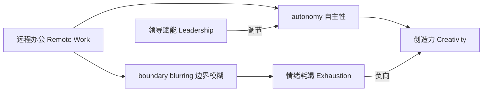
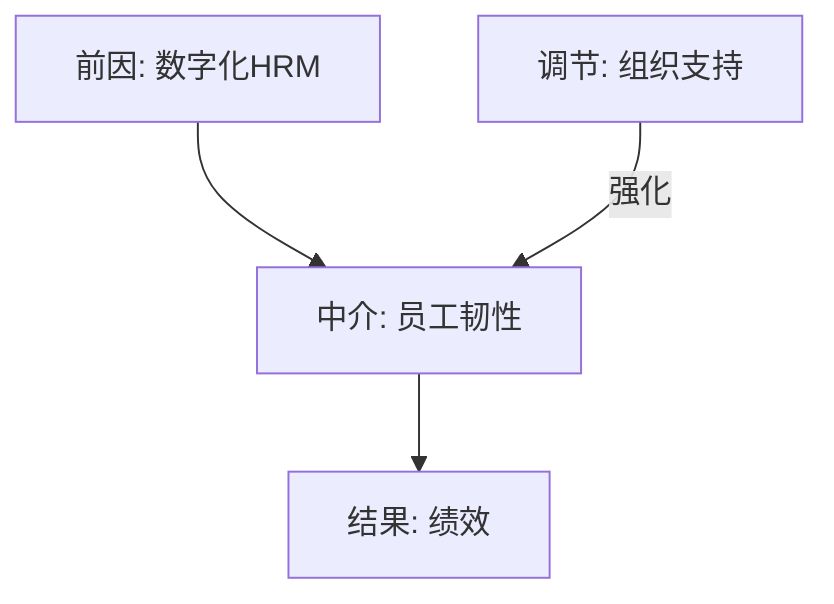
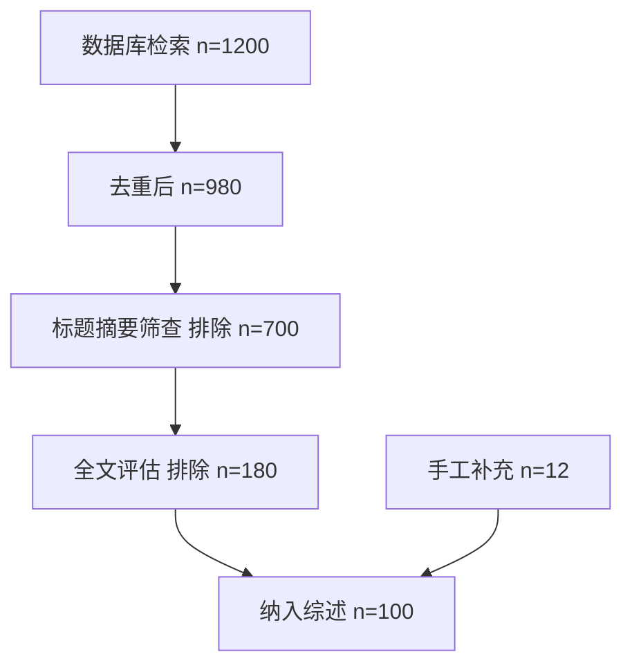
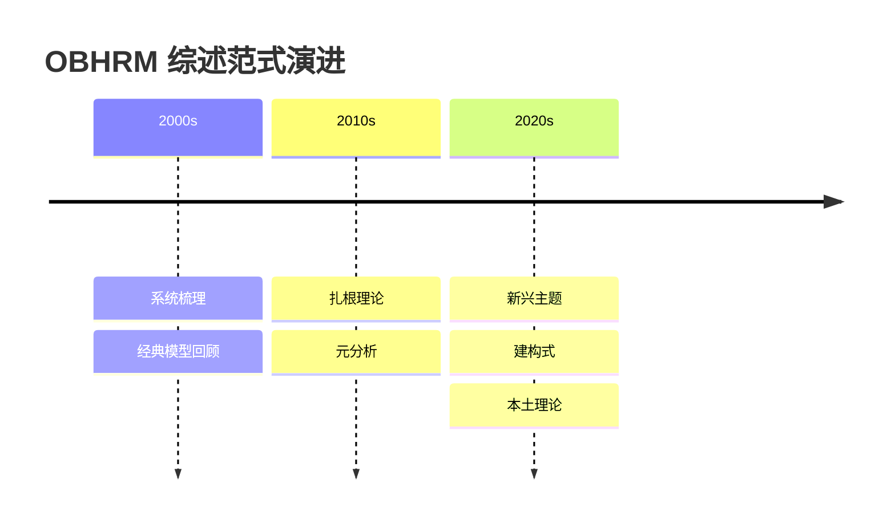
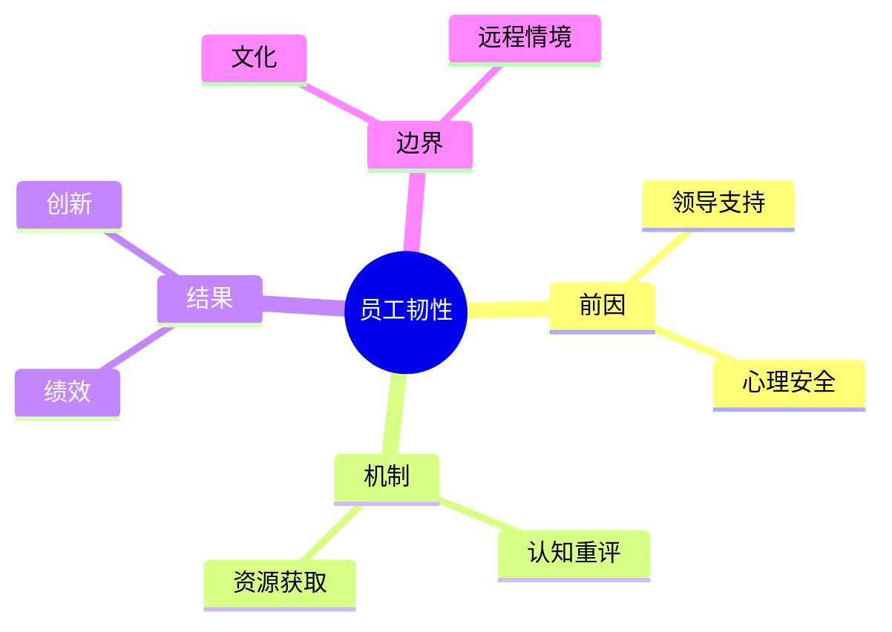
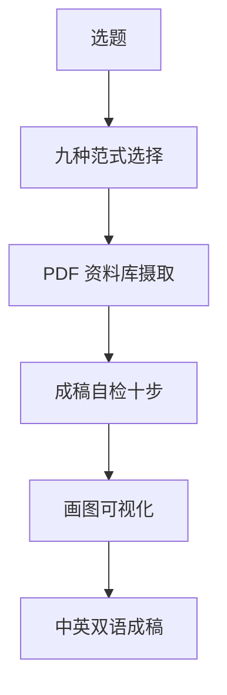

# 画图功能配方（轻量内联 Mermaid 备选）

> [注意] **正式综述配图请使用本技能内置 skills/obhrm-methodology/scripts/chart_engine.py（经 skills/obhrm-methodology/scripts/render_figures.py 封装）**：20 种图表、APA7、PDF+PNG 双输出，配套图表嵌入协议见 SKILL.md 第十节（画图功能）。本文件仅作为**快速内联预览**的 Mermaid 备选方案（即内联预览工具 Visualizer / `show_widget`，仅作快速预览，非正式交付配图）。
>
> 调用方式：先 `read_me(modules=["diagram"])` 加载样式，再用 `show_widget` 输出 Mermaid/SVG。
> 正式入口脚本见 `skills/obhrm-methodology/scripts/render_figures.py`；调用规范见 SKILL.md 第十节（画图功能）。
> 铁律：图是结构的视觉化，**须先有文本结构再画图**，不得用图替代论证。

## 一、理论框架图（构念–关系–机制）

## 二、概念关系图（变量网络）

## 三、PRISMA 流程图（纳排漏斗，呼应文献纳排审计）

## 四、演化时间线（经典回顾 / 扎根，范式五、二）

## 五、思维导图（主题聚类 ≤5主类×3子类，主题聚类审计）

## 六、OBHRM 综述实战集成图（建议默认产出）

把"九种范式 × 成稿自检十步 × 画图 × 双语"集成一张总览图，作为每次综述启动的导航。

