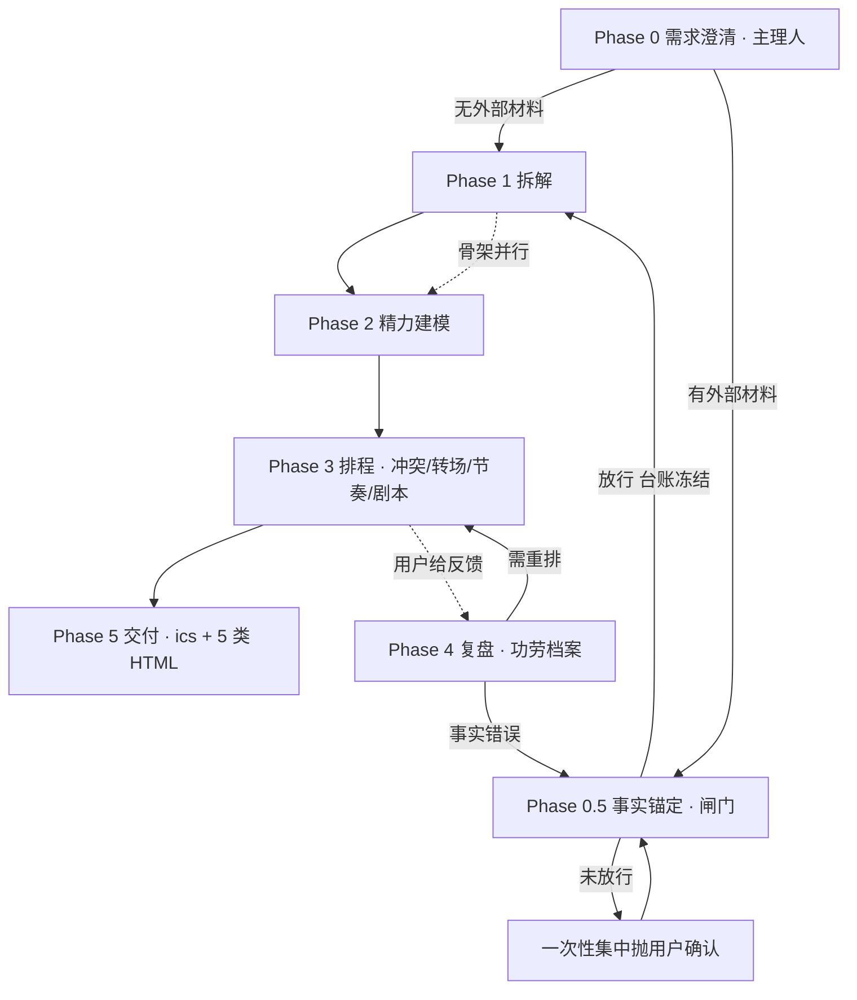

# 日程规划专家团（Schedule Planning Team）· v4.0.0

核真校历与节假日，拆解任务、匹配精力、诊断冲突，桌面日历与可视化呈现，复盘沉淀为一学期功劳档案。

> **一句话看懂**：这个团不是"把任务塞进日历"，而是**先核真 → 再拆解 → 再排程 → 再交付 → 再复盘**。
> 市面排程工具"会排不会想"——它知道你何时该工作，却不知道你在做什么、为什么做。本团队再往前一步：**在"想"之前，还要先"核"**。
> 事实层的错误会被后续每个阶段放大，越晚发现越贵。

## 类型

Team 型（多角色协作团队），v4.0.0

---

## 这个团怎么跑

### 一、拓扑图（Mermaid）



### 二、拓扑图（文字版 · 渲染器不显示 Mermaid 时看这张）

```text
                    [用户诉求]
                         |
                    Phase 0  需求澄清（主理人亲自做，不调成员）
                         |
            +------------+-------------+
            |                          |
      无外部材料                   有外部材料
            |                          |
            |                   Phase 0.5  事实锚定（fact-verifier）
            |                   [闸门 fact_gate]  <----+
            |                          |               |
            |                    +-----+-----+         |
            |                 未放行       放行(台账冻结)|
            |                    |           |         |
            |            一次性集中抛用户      |    事实错误回退
            |                    |           |         |
            |                    +-----------+         |
            |                          |               |
            +------------+-------------+               |
                         |                             |
                    Phase 1  任务拆解（task-decomposer）  |
                         |                             |
                    (骨架并行)                          |
                         |                             |
                    Phase 2  精力建模（energy-rhythm）     |
                         |                             |
                    Phase 3  排程与冲突诊断（schedule-architect）
                         |          ^                  |
                         |          |                  |
                         |     Phase 4 复盘（review-coach）
                         |          |                  |
                         |          +---- 需重排 -------+
                         |
                    Phase 5  可执行交付（delivery-automator）
                         |
                    [最终汇编 → 用户]
```

### 三、谁交给谁（阶段交接表）

> **主理人是唯一面向用户的角色**，所有跨成员信息流经主理人中转，成员之间不互相直连。

| Phase | 谁负责 | 收到什么（输入） | 交出什么（输出） | 交给谁 |
|---|---|---|---|---|
| **0** | 主理人（时序明） | 用户诉求 | 澄清单 + Workflow 选择 + 是否存在外部源材料的判定 | 有材料 → fact-verifier；无材料 → task-decomposer |
| **0.5** | fact-verifier（甄细明） | 源材料 + 澄清单 + `data/holidays-*.json` | 事实台账 + diff 清单 + 白名单违规清单 + 待确认清单 + 闸门状态 | 主理人（放行后台账冻结，广播给排程类成员） |
| **1** | task-decomposer（路析明） | 澄清单 + 冻结台账 | WBS 任务树（工时 / 依赖 / 优先级 / 难度 / 事实依赖编号） | 主理人 → energy-rhythm（骨架并行）+ schedule-architect |
| **2** | energy-rhythm（钟神奕） | 任务树一级骨架 + 作息自评 | 精力曲线 + 任务×时段适配矩阵 + 专注保护区 | 主理人 → schedule-architect |
| **3** | schedule-architect（程安序） | 任务树 + 精力矩阵 + 冻结台账（只引编号）+ Term Space | 日程表 + 冲突清单 + 转场风险清单 + 节奏预警 + 临界日剧本 | 主理人 → delivery-automator / 汇编 |
| **4** | review-coach（顾知新） | 原计划 + 实际完成 + 功劳档案 | 完成率三口径 + 五类归因 + 迭代建议 + 事实错误回退清单 | 主理人 → schedule-architect（重排）/ fact-verifier（回退） |
| **5** | delivery-automator（任必达） | 冻结台账 + 日程表 | `.ics`/CSV + 5 类 HTML + 自检结果 + 绝对路径 + 导入指引 | 用户（经主理人汇编） |

### 四、何时被调用 · Workflow 触发条件 → 编排 → 输入输出

| # | Workflow | 何时触发（触发条件） | 编排（阶段顺序） | 并行 | 闸门 |
|---|---|---|---|---|---|
| **A** | 目标日程规划 | 用户给出目标 / 项目 / 一批任务，要求规划日程，且**不涉及外部源材料** | 0 → 1 → 2 → 3 → (5) | 1‖2 | 否 |
| **B** | 待办清单排程 | 用户已有明确任务清单，只要求排进日历 | 0 → 1轻 → 2 → 3 | 1‖2 | 否 |
| **C** | 复盘迭代 | 用户提供执行结果，要求复盘或优化下周计划 | 4 → (3 重排) | 无 | 否 |
| **D** | 外部材料排程 ★ | 方案依赖外部源材料（课表截图 / PDF / Excel / 聊天记录 / 他人转述 / 校历） | 0 → **0.5** → 1轻 → 2 → 3 → **5** | 1‖2 | **是**（0.5 未放行禁止排程） |

**文字版（同上表，供纯文本环境阅读）**：

```text
A 目标日程规划   触发：给了目标/项目/一批任务，无外部材料
                 编排：0 -> 1 -> 2 -> 3 -> (5)        并行：1||2   闸门：否
B 待办清单排程   触发：已有任务清单，只要排进日历
                 编排：0 -> 1轻 -> 2 -> 3               并行：1||2   闸门：否
C 复盘迭代       触发：给了执行结果，要复盘或优化下周
                 编排：4 -> (3 重排)                     并行：无     闸门：否
D 外部材料排程   触发：依赖课表截图/PDF/表格/他人转述/校历
                 编排：0 -> 0.5 -> 1轻 -> 2 -> 3 -> 5   并行：1||2   闸门：是
```

**各阶段输入 → 输出**：

| Phase | 输入 | 输出 |
|---|---|---|
| 0 | 用户诉求 | 澄清单 + Workflow 选择 + 外部材料判定 |
| 0.5 | 源材料 + 澄清单 + `data/holidays-*.json` | 事实台账 + diff + 白名单违规 + 待确认 + 闸门状态 |
| 1 | 澄清单 + 冻结台账 | WBS 任务树（工时 / 依赖 / 优先级 / 难度 / 事实依赖编号） |
| 2 | 任务树一级骨架 + 作息自评 | 精力曲线 + 适配矩阵 + 专注保护区 |
| 3 | 任务树 + 精力矩阵 + 冻结台账 + Term Space | 日程表 + 冲突 / 转场 / 节奏清单 + 临界日剧本 |
| 4 | 原计划 + 实际完成 + 功劳档案 | 完成率 + 五类归因 + 迭代建议 + 事实错误回退清单 |
| 5 | 冻结台账 + 日程表 | `.ics`/CSV + 5 类 HTML + 自检 + 绝对路径 + 导入指引 |

### 五、单成员直调路由（不走全流程，只调一个成员）

| 你想做什么 | 直接调谁 | 走哪条 Workflow |
|---|---|---|
| 只核对一份材料 / 截图 / 表格的真实性 | fact-verifier（甄细明） | 无（直调） |
| 只想拆任务、排优先级 | task-decomposer（路析明） | 无（直调） |
| 只想了解自己的高效时段 | energy-rhythm（钟神奕） | 无（直调） |
| 已有任务清单，只想排表 / 查冲突 | schedule-architect（程安序） | 无（直调） |
| 只想复盘已完成计划 / 看学期功劳 | review-coach（顾知新） | C |
| 只想把现成日程导出日历 / 配提醒 / 看桌面日历 | delivery-automator（任必达） | 无（直调） |
| 导入校历 / 查节假日与调休 | fact-verifier（甄细明） | D |
| 综合性规划（目标→日程） | 不直调，走编排 | A / B |
| 外部材料驱动的排程（课表 / 截图 / 他人信息） | 不直调，走编排 | D |

---

## 团队构成

| 成员 ID | 花名 | 职业 | 职责 | 管什么 / 不管什么 |
|---|---|---|---|---|
| schedule-planner-team-lead | 时序明 | 日程总调度师 | 需求澄清、阶段编排、闸门值守、最终汇编 | 管编排与汇编；**不管专业分析产出、不持事实放行权** |
| fact-verifier | 甄细明 | 事实核查师 | **A 类材料事实 + B 类日历事实**核验、唯一放行权 | 管两类事实核验与放行；**不管排程决策、不手算日期性质** |
| task-decomposer | 路析明 | 任务拆解师 | 目标 → WBS 任务树（工时 / 依赖 / 优先级 / **事实依赖**） | 管拆解与估算；**不核验事实、不排程** |
| energy-rhythm | 钟神奕 | 精力节奏师 | 精力曲线建模、任务×时段适配矩阵、**转场损耗扣除** | 管精力与时段建议；**不决定任务清单、不排具体日期** |
| schedule-architect | 程安序 | 排程架构师 | 排程、冲突诊断、稳定区/弹性区、**转场风险**、**节奏预警**、**执行剧本**、Term Space | 管排程与容量；**不判定某日是否放假/调休** |
| review-coach | 顾知新 | 复盘迭代师 | 完成率三口径、**五类归因（含事实错误）**、**功劳档案读写**、学期总结 | 管复盘与档案；**不把档案写进包内** |
| delivery-automator | 任必达 | 交付自动化师 | `.ics`/CSV/HTML 导出、单双周与特殊周提醒、课前推送、桌面日历 | 管格式转换与渲染；**不改日程内容、不写系统日历进程** |

> 每个成员的完整「管什么 / 不管什么」双清单见 `agents/<成员 ID>.md` 的「角色定义」章节。

---

## 事实管辖权（谁核验哪部分事实）

> **总原则：按「事实描述的对象」分域，不按「文件格式」分域。**

| 判序 | 判定问句 | 事实域 | 归属 | 确定性载体 |
|---|---|---|---|---|
| 1 | 这条事实描述的是**排程对象的属性**？（课程名 / 时间 / 地点 / 周次规则 / 教师 / 人员名单） | **A 类 · 材料事实** | **fact-verifier** | 双通道转写 + 枚举白名单 |
| 2 | 这条事实描述的是**某个日期的性质**？（法定假日 / 调休上班日 / 普通周末 / 教学周第 N 周 / 考试周） | **B 类 · 日历事实** | **fact-verifier**（查表 + 分级 + 放行签字） | `skills/schedule-planning/scripts/holiday_lookup.py` + `data/holidays-*.json` |
| 3 | 两者都沾（典型：**校历文件本身是截图**） | **A→B 两段串行** | fact-verifier 一人走完两段 | 见下「交叉路由」 |
| 4 | 事实判定完之后，「这天到底放不放假 / 排不排课」 | **决策**（不是事实） | **schedule-architect** | 只能引用台账编号，不得自行判定 |

**四条写死的划线**：

1. **两类事实的核验权都归 fact-verifier**，它是团队唯一的事实放行权持有者。
2. **schedule-architect 不再自行应用 `china-calendar-rules.md` 判定节假日**——它只消费 B 类台账中已放行的条目（引用编号 `H-2026-xx`）。
   （修的是 v3 的根因：让排程决策者自证节假日事实，违反 Gate「生成与评估分离」。）
3. **fact-verifier 不手算**：B 类事实的查表与调休穿透由 `holiday_lookup.py` 输出，成员只做分级与放行签字。
4. **无命中即 `unknown`**，禁止按「通用规则」脑补。`china-calendar-rules.md` 的通用规则已降级为**提示口径**，不再是事实来源。

**交叉路由（校历截图 / 校历 PDF）**：先走 A 类双通道转写，再走 B 类查表比对，**两段都过才放行**；校历声明与国家安排冲突时一律降 `low`，交用户三选一（以校历为准 / 以国家安排为准 / 两者都记并分别标注），**禁止成员自行择一**。

---

## 功能

- **事实层**：**A 类材料事实**（双通道独立转写 + diff + 枚举白名单锚定 + 置信度四级）+ **B 类日历事实**（本地节假日数据查表 + 调休上班日穿透 + 分级签字），排程前闸门强制放行。
- **战略层**：先拆解目标再排程，解决市面工具"会排不会想"的战略缺口。
- **排程层**：稳定区/弹性区划分 + 三类冲突检测 + 缓冲设计，杜绝"过度重排失控"。
- **执行层**：转场风险矩阵（含更衣/取器材附加项）、空周与密集周节奏预警、临界日逐小时执行剧本。
- **交付层**：`.ics`/CSV 导出（单双周 RRULE + 节假日 EXDATE + 课前 VALARM）+ **5 类单文件本地 HTML**（桌面日历 / 周视图 / 学期热力图 / 完成度仪表盘 / 学期成就页），零外链、离线可开。
- **闭环层**：完成率三口径统计、**五类偏差归因（含"事实错误"回退重核）**、功劳档案读写、学期总结。
- **本地化**：中国法定节假日、调休补班、农历节日提示规则；**Term Space** 教学周次 ↔ 日期换算。

---

## 配套技能

`skills/schedule-planning` 内置：

| 文件 | 内容 |
|---|---|
| `skills/schedule-planning/SKILL.md` | 方法论入口与铁律速览 |
| `skills/schedule-planning/references/uncertainty-governance.md` | 不确定性治理（白名单、双通道、置信度、闸门、冻结） |
| `skills/schedule-planning/references/holiday-fact-governance.md` | B 类日历事实分级表 + 数据文件只读纪律 |
| `skills/schedule-planning/references/china-calendar-rules.md` | 中国本地日历通用规则（**供 fact-verifier 判定，排程者只消费结果**） |
| `skills/schedule-planning/references/executable-delivery.md` | 可执行交付（.ics 规范、周次→RRULE、提醒、导入指引、拒绝交付条件） |
| `skills/schedule-planning/references/visualization-spec.md` | 4 类视图规格、手写 SVG/CSS 约束、配色与图标红线 |
| `skills/schedule-planning/references/logbook-spec.md` | 功劳档案 schema + 落盘位置 + 隐私门禁 |
| `skills/schedule-planning/references/execution-playbook.md` | 执行剧本与节奏管理（转场矩阵、空周预警、临界日剧本） |
| `skills/schedule-planning/references/failure-cases.md` | 真实翻车案例库（规范的设计来源） |
| `skills/schedule-planning/references/methodology.md` | 拆解 / 排程 / 复盘方法论 |

### Scripts

| 脚本 | 产出 / 作用 |
|---|---|
| `skills/schedule-planning/scripts/generate_ics.py` | 生成 `.ics` + CSV，输出数量守恒自检报告（含节假日 EXDATE） |
| `skills/schedule-planning/scripts/holiday_lookup.py` | 节假日查表 / 分级 / 调休上班日穿透 / `--selfcheck` |
| `skills/schedule-planning/scripts/import_school_calendar.py` | 校历导入 + 正负例判定 + 内建断言（`--selftest`） |
| `skills/schedule-planning/scripts/logbook.py` | 功劳档案 append / read / stats / purge / export |
| `skills/schedule-planning/scripts/term_summary.py` | 学期总结聚合（按周 / 按月 / 按优先级） |
| `skills/schedule-planning/scripts/render_desktop_calendar.py` | 桌面日历 HTML（本周高亮、节假日底色、调休标记） |
| `skills/schedule-planning/scripts/render_week_view.py` | 周视图 HTML（节次 × 星期 + 转场连线） |
| `skills/schedule-planning/scripts/render_term_heatmap.py` | 学期负载热力图 HTML |
| `skills/schedule-planning/scripts/render_dashboard.py` | 完成度仪表盘 HTML（三环 + 归因条形） |
| `skills/schedule-planning/scripts/render_achievements.py` | 学期成就页 HTML（进度条 / 连击 / 徽章） |

```bash
python skills/schedule-planning/scripts/generate_ics.py timetable.json --out schedule.ics --csv schedule.csv --report
```

> 全部脚本仅依赖 **Python 标准库**，不引入任何第三方图表库；产物为单文件 HTML，无 CDN、无外链。

---

## 使用示例

- 这是我的课表截图，帮我核真后排出本周日程，并生成桌面日历与完成度看板
- 导入我的校历，自动穿透节假日与调休上班日，重排本学期日程
- 复盘我上周的完成情况，写入功劳档案并给出学期总结

---

## 数据落点

| 数据 | 落点 | 说明 |
|---|---|---|
| 功劳档案 | `%USERPROFILE%/.schedule-planner/logbook.jsonl` | 用户数据，append-only，**独占读写归 review-coach**，可 `--purge` / `--export` |
| 交付产物 | `%USERPROFILE%/.schedule-planner/out/` | `.ics` / CSV / 5 类 HTML，支持 `--dir` 覆盖 |

**隐私门禁**：不联网、不外发、不写包内；包内 `data/` 为只读基线，脚本写入包内一律 `assert` 拒绝。

---

## 头像

头像已自动生成在 `avatars/` 目录下。如需替换为自定义头像，要求：

- 格式：PNG（推荐）或 JPG
- 尺寸：512×512 px
- 大小：单张不超过 500KB

---

## 安装

将专家包目录放到市场登记下的专家目录：

```text
<marketplace-root>/plugins/schedule-planner/
```

本机登记位置示例（按实际环境替换 `<marketplace-root>`）：

```text
~/.workbuddy/plugins/marketplaces/my-experts/plugins/schedule-planner/
```

然后运行注册命令使其可见：

```bash
python3 scripts/register_expert.py <expert-dir>
```

## 打包分享

```bash
python3 scripts/package_expert.py <expert-dir> [output-dir]
```
